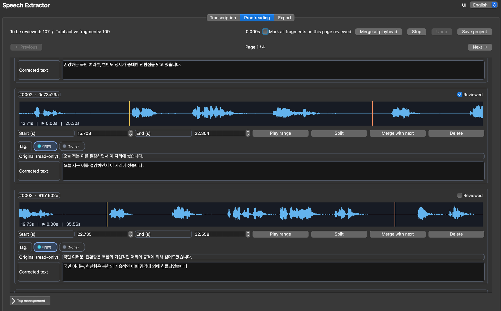

<div align="center">
  <picture>
    
  </picture>

  <h1>音声切り出しツール（Speech Extractor）</h1>

  <strong>音MAD制作のための音声素材抽出ツール</strong><br><br>
  <picture>
    
  </picture>
  
  [**English**](./README.md) | [**한국어**](./README.ko.md) | [**日本語**](./README.ja.md)

  <a href="#概要と機能"><strong>概要と機能</strong></a> |
  <a href="#インストールと実行方法"><strong>インストールと実行方法</strong></a> |
  <a href="#注意事項"><strong>注意事項</strong></a> |
  <a href="#ライセンスと謝辞"><strong>ライセンスと謝辞</strong></a>
</div>

> [ChatGPT](https://chatgpt.com)によるバイブコーディングを通じて開発されました。

> Windows、macOS、Linuxなどのマルチプラットフォームに対応しています（64ビット版WindowsおよびApple Silicon環境で動作確認済み）。

> 本ツールには<u>**ノイズやBGMを除去する機能はありません**</u>。ご使用前に、[UVR](https://github.com/anjok07/ultimatevocalremovergui) や [MSST](https://github.com/SUC-DriverOld/MSST-WebUI) などの別途用意されたソフトウェアで音声分離を行ってからご使用ください。

> 本ツールはフレーズまたは文章単位で音声素材を抽出するため、ロールプレイやラップ制作など、セリフを並べて使用する用途に最適化されています。発音矯正用としては、音節単位で分割できるOrange0929さんの [source extractor](https://github.com/Orange0929/Source_extractor)の使用をおすすめします。

> コードなどに関するお問い合わせは、[DCinside合成・動画チャンネルの投稿](https://gall.dcinside.com/videocomp/7138)にコメントをお寄せください。

## 概要と機能

武鉉文火災研究会の韓国政治合成研究室傘下のHangsUs AI学習グループによって開発された本アプリケーションは、[Faster Whisper](https://github.com/SYSTRAN/faster-whisper) を利用して、音MADの制作に必要な音声素材を自動的に文字起こしします。その後、MelodyneやVocalShifterでも使用可能な48kHz 16bit WAV形式の音声素材パックを提供するほか、SRT字幕ファイルも生成することで、動画制作との連携も可能にし、音MADの制作者の利便性を高めることを目的としています。本アプリケーションの主な機能は以下のとおりです。

- 本アプリケーションは `uv sync` を使用することで、実行に必要なパッケージを迅速にインストールし、バージョンを簡単に管理できます。
- 言語は、プログラム起動時に右上の言語設定タブから英語（デフォルト）、韓国語、日本語に変更できます。
- プロジェクトフォルダを設定することで、音声ソース分析専用の作業領域を確保できます。各プロジェクトはUUIDによって識別され、重複することはありません（プロジェクト名は重複可能なため、混同しないようご注意ください）。
- プロジェクトの読み込み機能を使用することで、修正しきれなかったテキストを後から編集できます。
- PyAVモジュールを使用して、音声・動画ファイルをPCM S16LE、48 kHzのステレオ／モノラルWAVファイルに自動変換します（ファイル名は `reference.wav` に固定されています）。
- Whisper Modelを自由に選択でき、CTranslate2上で動作するよう自動的に処理されます。WindowsではCUDAアクセラレーションにも対応しています。
- Faster Whisperに内蔵されている [Silero VAD](https://github.com/snakers4/silero-vad) を利用することで、Whisperによる長時間の文字起こしで発生しやすい幻覚（Hallucination）を防ぎ、文字起こしの精度を向上させます（VAD設定のカスタマイズも可能です）。
- 文字起こし完了後、Proofreadingタブで各フレーズ・文章の時間を調整できるほか、誤って文字起こしされたテキストを修正できます。各ページには30文ずつ配置されており、個別またはページ単位で一括して校正完了のチェックを行えます。
- 波形をクリックすると、選択した位置に再生位置を移動できます。再生バー上で `S` キーを押すと区間を2つに分割でき、`CTRL(CMD) + M` キーを押すと次の区間と結合できます。誤って区間を分割、結合、または削除してしまった場合でも、取り消しボタン、または `CTRL(CMD) + Z` キーを押すことで元の状態に戻すことができます。
- 区間の分割、結合、削除機能を実装しています。現在の再生位置で `S` キーを押すと、区間を2つに分割できます。誤って文章を分割・結合・削除してしまった場合でも、元の状態に戻せる取り消しボタンが用意されています。
- コードの複雑さと実用性の低さを考慮し、自動話者分離機能は実装していませんが、タグ機能を使用することで最大10人まで手動で話者を指定できます。タグはProofreadingタブ下部の管理欄を展開または折りたたむことで管理できます。視認性を高めるため、話者（タグ）ごとに色を設定できるほか、デフォルトタグも設定できます。タグが割り当てられた文章は、後のエクスポート時にタグごとの個別フォルダに格納されます。
- 校正作業を途中で中断しなければならない場合でも、プロジェクト保存機能を利用することで、プロジェクトを読み込み、作業を再開できます。
- エクスポート時には、文章の順番に従ってファイル名に連番を付けるオプション（桁数に合わせて先頭に0が追加されます）と、ZIP圧縮ファイルとしてエクスポートするオプションを選択できます。ZIP圧縮オプションを選択した場合でも、生成されたWAVファイルが自動的に削除されることはありません。
- エクスポート時には、PyAVによってタイムコードに基づいて切り出された文章ごとのWAVファイルとともに、SRT形式の全字幕ファイルが `ai_subtitle.srt` という固定ファイル名で生成されます（字幕生成を無効にする機能はありません）。
- 完了したプロジェクトは、`send2trash` モジュールを利用して即座に削除されるのではなく、ゴミ箱へ移動されます（ただし、Windowsではプロジェクトを開いている間は削除できません）。そのため、誤ってプロジェクトを削除してしまった場合でも復元できます。

## インストールと実行方法

本アプリケーションでは、公式にパッケージマネージャー [uv](https://github.com/astral-sh/uv) を使用した迅速かつ簡単なインストールを推奨しています。各OSや環境設定に応じたuvのインストール方法については、[uv公式ドキュメント](https://docs.astral.sh/uv/getting-started/installation) をご参照ください。また、Faster WhisperやPyAVなど、実行時やモデル変換に必要なすべての依存パッケージは `pyproject.toml` に記載されているため、別途 `requirements.txt` ファイルは提供していません。Torchなどの容量の大きいパッケージが多数含まれているため、依存関係の解決時に必要なディスク容量が数GB単位になる場合があることをご了承ください。なお、FFmpegについてはPyAVのwheelにライブラリが含まれているため、別途インストールする必要はありません。

uvのインストールが完了したWindows、macOS、Linuxユーザーは、`git` または手動で（ページ上部の緑色のCodeボタンをクリックし、Download ZIPを選択）本Speech Extractorリポジトリを取得してください。その後、Windowsでは `run_windows.bat` を、macOSまたはLinuxでは `run_macos_linux.sh` を実行するだけで、uvが自動的にパッケージをインストールしてアプリケーションを起動するため、非常に簡単に利用できます。

ただし、通常の手順としては、Windowsの場合はPowerShellまたはコマンドプロンプト、macOSやLinuxの場合はターミナルで `cd` コマンドを使用してアプリケーションのフォルダに移動し、以下のコマンドを入力することで、依存パッケージのインストールとアプリケーションの起動を行えます。

```bash
uv sync
uv run python main.py
```

本アプリケーションは64ビット版WindowsおよびApple Silicon搭載Mac環境でのみ動作確認されているため、Linuxでは環境によって追加のQtプラグインやCUDA関連パッケージのインストールが必要になる場合があります。

また、アプリケーションのリリース時点（2026年11月）における `nvidia-cublas-cu12` の最新バージョンは [12.9.3.13](https://pypi.org/project/nvidia-cublas-cu12/12.9.3.13/#files) ですが、このバージョンはLinux用のwheelのみが配布されています。そのため、Windowsで依存パッケージのインストール中に当該パッケージのインストールエラーが発生した場合は、`pyproject.toml` ファイル内のnvidia-cublas-cu12のバージョンを以下のように `12.9.2.10` に指定し、再度実行してください。

```
"nvidia-cublas-cu12==12.9.2.10; sys_platform == 'win32'"
```

### CUDAアクセラレーション

本アプリケーションは、CTranslate2がCUDAデバイス（NVIDIA製GPU）を検出すると自動的にCUDAを選択し、検出できない場合はint8を使用したCPUモードで実行されます。現在のCTranslate2ビルドでは、GPU推論のためにCUDA 12およびcuDNN 9のランタイムライブラリが必要です。

Windowsでは `uv sync` を実行すると、CUDA 12 cuBLAS、CUDA Runtime、およびcuDNN 9のwheelパッケージがプロジェクト環境にインストールされます。また、アプリケーションはCTranslate2を読み込む前に、該当するDLLフォルダをプロセスの検索パスに追加します。ただし、互換性のあるNVIDIAディスプレイドライバーは別途必要です。

Linuxでは、使用しているディストリビューションに適したNVIDIA CUDA 12/cuDNN 9ランタイムライブラリを、Faster Whisperのインストールガイドに従ってインストールする必要があります。

macOSの場合、Faster WhisperはMetalアクセラレーションに対応していないため、Metalを利用するにはWhisperの実装を [whisper.cpp](https://github.com/ggml-org/whisper.cpp) に置き換えるコードを別途作成する必要があります。

## Faster Whisper関連

本ツールでは、`Systran/faster-whisper-large-v3` をはじめとするFaster Whisper開発元Systranのモデル、および韓国語専用モデルである `seastar105/whisper-medium-komixv2` を標準で選択できるようにしています（Systranのモデルについては [こちら](https://huggingface.co/Systran)、komixv2モデルについては [こちら](https://huggingface.co/seastar105/whisper-medium-komixv2) で詳細を確認できます）。また、これら以外の各種Whisperモデルも使用可能です。

ただし、Systran系のモデルを除き、Hugging Faceで配布されている一般的なWhisperモデルはTransformers形式のチェックポイントである一方、Faster Whisperは独自のCTranslate2形式の重みを使用します。そのため、初回使用時にはアプリケーションが必要なモデルファイルをダウンロードした後、ct2-transformers-converterを実行してローカルにCTranslate2形式のコピーを生成します。

変換されたファイルは、OSのユーザーキャッシュディレクトリに保存されます。

- Windows: `%LOCALAPPDATA%\speech-extractor\ctranslate2`
- macOS: `~/Library/Caches/speech-extractor/ctranslate2`
- Linux: `$XDG_CACHE_HOME/speech-extractor/ctranslate2` または `~/.cache/speech-extractor/ctranslate2`

初回の変換時には、数GBの一時ファイルおよびキャッシュ用ディスク容量が必要になる場合があり、処理にも多少時間がかかることがあります。カスタムのHugging Face Transformers Whisperチェックポイントは、リポジトリIDまたはローカルフォルダのパスを入力することで使用できます。ただし、対象のファイルはTransformers Whisperコンバーターとの互換性が必要です。

### コミュニティ製CTranslate2モデルにおける `tokenizer.json` の欠落

一部のWhisperモデルには `model.bin` が含まれているものの、`tokenizer.json` が欠落している場合があります。本アプリケーションは、このような不完全なファイル構成を検出し、リポジトリ内のトークナイザーファイルを使用してfaster-whisper用のトークナイザーを生成した後、生成された `tokenizer.json` をアプリケーション独自のモデルキャッシュに保存します。なお、Hugging Faceのスナップショット自体は変更されません。

## 注意事項

- 指示文やアイコンの追加を除き、本アプリケーションはすべてChatGPT（無料モデル）によるバイブコーディングで開発されており、特定の条件下でのみ動作確認を行っています。そのため、使用環境によって予期しないエラーが発生する可能性がありますので、ご使用の際はご注意ください。
- Qtによる音声再生の対応状況は、OS上で利用可能なQt Multimediaバックエンドによって異なる場合があります。
- MelodyneおよびVocalShifterでの使用に最適化するため、エクスポート形式はPCM16 48kHz WAVファイルのみに限定されています。また、SRT字幕のエクスポートも任意に無効化することはできません。
- デフォルト設定で `whisper-medium-komixv2` モデルを使用した場合、文や節単位ではなく、段落単位で文字起こしが行われる傾向があり、一部の区間が文字起こしされないことがあります。このような場合は、Whisper の設定にある `condition_on_previous_text` オプションを無効（False）にすることで、文字起こしされない区間を減らせる場合があります。
- プロジェクトの誤削除を防ぐため、削除機能ではプロジェクトフォルダをゴミ箱に移動するだけとなっています。プロジェクトフォルダを完全に削除するには、ゴミ箱からも削除する必要があります。
- Windows では、現在開いているプロジェクトをそのまま削除できない問題が確認されています。プロジェクトを削除するには、新規プロジェクトボタンを押すか、アプリケーションを再起動してから削除してください。

## ライセンスと謝辞

本アプリケーションはMITライセンスに基づいて公開されており、ソースコードを自由に変更・再配布することができます。そのため、独自にブランチをフォークして個別に改善を加えたうえで配布していただいても問題ありません。

最後に、本アプリケーションの開発にあたり、インスピレーションとご協力をいただいたムンコさん、そしてロゴの使用を許可してくださった물리는노무현（物理は盧武鉉）さんに心より感謝申し上げます。
