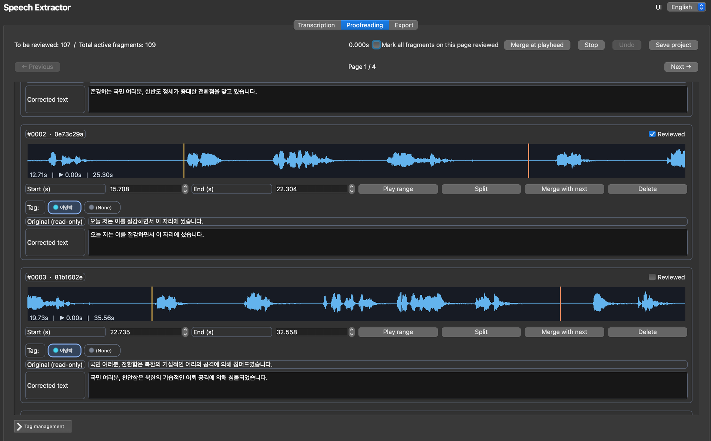

<div align="center">
  <picture>
    
  </picture>

  <h1>음원 소스 추출기(Speech Extractor)</h1>

  <strong>합성을 위한 음원 소스 추출기</strong><br><br>
  <picture>
    
  </picture>

  [**English**](./README.md) | [**한국어**](./README.ko.md) | [**日本語**](./README.ja.md)

  <a href="#소개-및-기능"><strong>소개 및 기능</strong></a> |
  <a href="#설치-및-실행법"><strong>설치 및 실행법</strong></a> |
  <a href="#주의점"><strong>주의점</strong></a> |
  <a href="#라이센스-및-사사"><strong>라이센스 및 사사</strong></a>
</div>

> [ChatGPT](https://chatgpt.com) 바이브 코딩을 통해 제작되었습니다.

> 윈도우, 맥, 리눅스 등 멀티 플랫폼 지원합니다 (64비트 윈도우, 애플 실리콘에서 검증 완료)

> 본 추출기는 **<u>잡음 또는 배경음악 제거 기능을 제공하지 않습니다.</u>** 사용 전 [UVR](https://github.com/anjok07/ultimatevocalremovergui) 또는 [MSST](https://github.com/SUC-DriverOld/MSST-WebUI)와 같은 별도 프로그램을 통해 음원 분리 진행 후 사용해주시기 바랍니다.

> 본 추출기는 절이나 문장 단위로 소스를 추출하므로 상황극, 랩 제작 등 대사나열에 최적화되어 있습니다. 발음 조교용으로는 음절 단위로 분리하는 렌지 님의 [source extractor](https://github.com/Orange0929/Source_extractor) 사용을 추천 드립니다.

> 코드 등 문의에 관해서는 [디시인사이드 합성-영상 게시글](https://gall.dcinside.com/videocomp/7138)에 댓글로 남겨주세요.

## 소개 및 기능

무현문화재연구회(武鉉文火災硏究會) 한국정치합성연구실 산하 HangsUs AI 스터디 그룹에서 제작한 본 프로그램은 [Faster Whisper](https://github.com/SYSTRAN/faster-whisper)를 활용하여 음원 합성에 필요한 음원 소스를 자동으로 전사한 후, 멜로다인이나 보컬쉬프터에서도 사용가능한 48kHz 16bit WAV 파일 구성의 소스팩을 제공함은 물론, SRT 자막 파일도 제공함으로써 영상 합성과도 연동이 될 수 있도록 합성가들의 편의를 도모한 프로그램입니다. 본 프로그램의 세부 기능은 다음과 같습니다:

- 본 애플리케이션은 `uv sync`를 통해 구동에 필요 패키지를 신속하게 설치하고 쉽게 버전을 관리할 수 있습니다.
- 언어는 프로그램 실행시 우측 상단의 언어 설정탭을 통해 영어(기본 설정), 한국어, 일본어로 바꿀 수 있습니다.
- 프로젝트 폴더 설정을 통해 소스 분석 전용 구역을 갖출 수 있습니다. 각 프로젝트는 UUID로 구분되어 중복되지 않습니다(프로젝트명 중복 가능하므로 헷갈리지 않도록 주의 바랍니다).
- 프로젝트 불러오기를 통해 미처 교정하지 못한 텍스트를 수정할 수 있습니다.
- PyAV 모듈을 통해 소스 음원/영상을 PCM S16LE, 48 kHz 스테레오/모노 WAV 파일로 자동 변환합니다(`reference.wav`로 고정).
- Whisper Model을 자유로이 선택할 수 있으며, CTranslate2 상에서 구동될 수 있도록 자동 처리합니다. 윈도우의 경우 CUDA 가속을 지원합니다.
- Faster Whisper에 내장된 [Silero VAD](https://github.com/snakers4/silero-vad)를 통해 Whisper 특유의 장기간 전사(transcription) 시 환각 발생을 방지하고 전사의 정확성을 높입니다(VAD, Whisper 설정 각각 커스텀 가능).
- 전사가 종료된 후 교정(Proofreading) 탭에서 각 절/문장의 진행 시간을 조정함은 물론 잘못 전사된 텍스트를 교정할 수 있습니다. 각 페이지 별로 30개의 문장이 배치되어 있으며, 각각 또는 페이지 단위의 일괄 교정 확인 체크를 할 수 있습니다.
- 파형을 클릭하면 해당 위치로 재생 위치를 이동할 수 있으며, `Shift` 키를 누른 채 클릭하면 시작 지점을 설정하고, `Ctrl/Cmd` 키를 누른 채 클릭하면 종료 지점을 설정할 수 있습니다. 또한 시작점과 종료점 경계를 드래그하여 조정할 수도 있습니다. 구간 재생 기능은 `Space` 키로, 교정 후 자동으로 교체 체크 및 다음 문장 넘어가는 기능은 `Enter` 키로 가능합니다.
- 구간 분리, 병합, 삭제 기능이 구현되어 있습니다. 현재 재생바에 `S`키를 눌러 양 구간으로 분리, `CTRL(CMD) + M`키로 다음 단락과 병합할 수 있습니다. 실수로 문장을 분리/병합/삭제하더라도 취소 버튼, 또는 `CTRL(CMD) + Z`키를 눌러 원상 복구 가능합니다.
- 비록 자동 화자분리 기능은 코드의 복잡성과 낮은 실효성을 이유로 도입하지 않았으나, 태그 기능을 통해 화자를 수동으로 최대 10명까지 지정할 수 있습니다. 태그는 교정 탭 하단의 관리란을 펼치거나 접어 관리할 수 있습니다. 가시성을 위해 화자(태그)별로 색상을 지정할 수 있으며, 기본 태그도 설정할 수 있습니다. 태그 지정된 문장들은 추후 태그별로 별도의 폴더에 담겨 추출됩니다.
- 교정을 중도에 중지해야 하는 상황이 발생하여도 프로젝트 저장 기능이 있어 프로젝트 불러오기 기능을 통해 교정을 속행할 수 있습니다.
- 내보내기에서는 문장 순서대로 파일명 번호를 붙여(자릿수에 맞춰 앞에 0이 붙습니다) 내보낼 수 있는 옵션과 ZIP 압축파일로 내보내는 옵션을 선택할 수 있습니다. ZIP 압축파일 옵션을 선택하더라도 생성된 WAV 파일들은 자동 삭제되지 않습니다.
- 내보내기시 PyAV로 타임코드에 따라 잘린 문장별 WAV 파일과 함께 SRT 전체 자막 파일이 `ai_subtitle.srt` 이름 고정으로 생성됩니다(자막 생성 끄는 기능 없음).
- 완료한 프로젝트는 `send2trash` 모듈을 활용하여 곧바로 삭제되지 않고 휴지통으로 옮겨집니다(단, 윈도우의 경우 프로젝트가 열려있는 동안에는 삭제 불가능합니다). 따라서 착오로 프로젝트를 지우더라도 다시 복구할 수 있습니다.

## 설치 및 실행법

공식적으로 본 애플리케이션은 패키지 관리자 [uv](https://github.com/astral-sh/uv)를 통한 신속하고 간편한 설치를 추천합니다. 각 운영체제 또는 환경설정에 맞는 uv 설치법은 [uv 공식 문서](https://docs.astral.sh/uv/getting-started/installation) 참고 바랍니다. 그리고 Faster Whisper, PyAV 등 런타임/모델 변환 등에 필요한 모든 의존성 패키지 리스트는 `pyproject.toml`에 적혀있으므로 별개의 `requirements.txt` 파일이 제공되지 않으며, Torch 등 무거운 패키지가 다수 포함되어 의존성 해소시 폴더 크기가 GB 단위로 커질 수 있다는 점 양해 바랍니다. FFmpeg의 경우 PyAV 휠에 라이브러리가 포함되어 있어 별도로 설치하실 필요 없습니다.

uv 설치가 완료된 윈도우, 맥, 리눅스 유저는 본 Speech Extractor 저장소(repository)를 `git` 또는 수동(상단 초록색 Code 버튼 클릭 후 Download ZIP 클릭)으로 복제한 다음 윈도우의 경우 `run_windows.bat`을, 맥이나 리눅스에서는 `run_macos_linux.sh`을 실행함으로써 uv가 자동으로 패키지를 설치하고 애플리케이션을 실행시켜 매우 간단하게 이용하실 수 있습니다. 다만 정석적으로는 윈도우의 경우 파워쉘이나 명령 프롬프트 창에서, 맥이나 리눅스에서는 터미널에서 `cd` 명령어를 통해 애플리케이션 폴더로 이동 후 다음 명령어를 입력하여 의존성 패키지 설치 및 애플리케이션 실행을 할 수 있습니다.

```bash
uv sync
uv run python main.py
```

본 애플리케이션은 64비트 윈도우와 실리콘 맥 환경에서만 구동이 검증되었기 때문에, 리눅스의 경우 추가적인 Qt 플러그인이나 CUDA 관련 패키지 설치가 추가로 필요할 수 있습니다. 또한 애플리케이션 배포 시점(2026년 11월) 기준으로 `nvidia-cublas-cu12` 최신 버전은 [12.9.3.13](https://pypi.org/project/nvidia-cublas-cu12/12.9.3.13/#files)이나 리눅스 휠만 배포되어 있기에, 만약 윈도우에서 의존성 패키지 설치 중 해당 패키지 설치에 오류가 발생한 경우 `pyproject.toml` 파일에서 nvidia-cublas-cu12 버전을 다음과 같이 `12.9.2.10`버전으로 지정하고 다시 실행해주시길 바랍니다.

```
"nvidia-cublas-cu12==12.9.2.10; sys_platform == 'win32'"
```

### CUDA 가속

본 애플리케이션은 CTranslate2가 CUDA 장치(Nvidia 계열 그래픽카드)를 감지하면 자동으로 CUDA를 선택하고, 그렇지 않으면 int8을 사용하는 CPU 모드로 실행됩니다. 현재 CTranslate2 빌드는 GPU 추론을 위해 CUDA 12 및 cuDNN 9 런타임 라이브러리가 필요합니다. 윈도우에서는 `uv sync`를 실행하면 CUDA 12 cuBLAS, CUDA 런타임 및 cuDNN 9 휠 패키지가 프로젝트 환경에 설치되며, 애플리케이션은 CTranslate2를 로드하기 전에 해당 DLL 폴더를 프로세스의 검색 경로에 추가합니다. 단, 호환되는 NVIDIA 디스플레이 드라이버는 여전히 필요합니다. 리눅스에서는 사용하는 배포판에 맞는 NVIDIA CUDA 12/cuDNN 9 런타임 라이브러리를 Faster Whisper의 설치 안내에 따라 설치해야 합니다.

맥의 경우 Faster Whisper가 Metal 가속을 지원하지 않기 때문에, 이를 위해서는 Whisper 구동을 [whisper.cpp](https://github.com/ggml-org/whisper.cpp)로 대체하는 코드를 별도로 작성하셔야 합니다.

## Faster Whisper 관련

본 추출기는 `Systran/faster-whisper-large-v3`을 위시로 Faster Whisper 개발사 Systran의 모델들 및 한국어 전용모델인 `seastar105/whisper-medium-komixv2`을 기본적으로 선택할 수 있도록 하였으며(Systran은 [여기](https://huggingface.co/Systran), komixv2 모델은 [여기](https://huggingface.co/seastar105/whisper-medium-komixv2)에서 정보를 확인하실 수 있습니다), 이외에도 여타 Whisper 모델들을 사용할 수 있도록 하였습니다.

다만, Systran 계열을 제외하고 Hugging Face에서 배포되는 일반적인 Whisper 모델들은 Transformers 형식의 체크포인트인 반면, Faster Whisper는 별도의 CTranslate2 가중치를 사용하기 때문에, 최초 사용 시 앱은 필요한 모델 파일을 다운로드한 다음 ct2-transformers-converter를 실행하여 로컬 CTranslate2 사본을 생성합니다. 변환된 파일은 운영체제의 사용자 캐시 디렉터리에 저장됩니다.

- 윈도우: `%LOCALAPPDATA%\speech-extractor\ctranslate2`
- 맥OS: `~/Library/Caches/speech-extractor/ctranslate2`
- 리눅스: `$XDG_CACHE_HOME/speech-extractor/ctranslate2` or `~/.cache/speech-extractor/ctranslate2`

최초 변환 시에는 수 GB의 임시 및 캐시 디스크 공간이 필요할 수 있으며, 작업에 다소 시간이 걸릴 수 있습니다. 사용자 지정 Hugging Face Transformers Whisper 체크포인트는 저장소 ID 또는 로컬 폴더 경로를 입력하여 사용할 수 있습니다. 단, 해당 파일들이 Transformers Whisper 변환기와 호환되어야 합니다.

### 커뮤니티 CTranslate2 모델에서의 `tokenizer.json` 누락

일부 Whisper 모델은 `model.bin`이 포함되어 있지만 `tokenizer.json`이 누락되어 있을 수 있습니다. 본 애플리케이션은 이러한 불완전한 파일 구성을 감지하고, 저장소에 있는 토크나이저 파일을 사용하여 faster-whisper 토크나이저를 생성한 다음, 생성된 `tokenizer.json`을 애플리케이션 자체 모델 캐시에 저장합니다. Hugging Face 스냅샷은 변경되지 않고 그대로 유지됩니다.

## 주의점

- 해당 애플리케이션은 지시사항 및 아이콘 추가를 제외하면 전부 ChatGPT(무료 모델) 바이브 코딩으로 제작되었으며 특정 조건에서만 구동을 검증하였기 때문에 사용자의 환경에 따라 예기치 못한 오류가 발생할 수 있으니 사용시 주의 바랍니다.
- Qt의 오디오 재생 지원 여부는 운영체제에서 사용할 수 있는 Qt 멀티미디어 백엔드에 따라 달라질 수 있습니다.
- 멜로다인 및 보컬쉬프터에서의 사용 최적화를 위해 오직 PCM16 48kHz WAV파일로만 내보내기가 진행되며, SRT 자막 내보내기 또한 임의로 제외할 수 없습니다.
- 기본 설정으로 `whisper-medium-komixv2` 모델 사용시 문장, 절 단위가 아닌 문단 단위로 전사가 진행되고 일부 구간이 전사되지 않는 경향이 발견됩니다. 이때 Whisper 설정 중 `condition_on_previous_text` 옵션을 끄면(False) 전사되지 않는 구간이 줄어드니 참고 바랍니다.
- 착오로 프로젝트를 날리는 불상사를 막기 위해 삭제 기능은 프로젝트 폴더를 휴지통으로 보낼뿐이기에, 실제 프로젝트 폴더를 지우기 위해서는 휴지통에서도 삭제하셔야 합니다.
- 윈도우에서 열려있는 프로젝트를 곧바로 삭제할 수 없는 문제점이 있습니다. 새 프로젝트 버튼을 누르거나 애플리케이션 재실행 후 삭제 바랍니다.

## 라이센스 및 사사

본 애플리케이션은 MIT 라이센스를 따라 자유롭게 소스 코드를 수정하거나 배포하실 수 있습니다. 따라서 직접 브랜치를 분기하여 개별적으로 코드를 개선하여 배포하셔도 좋습니다.

마지막으로 본 애플리케이션 제작에 영감과 도움을 주신 문코, 또 로고 사용을 허락해주신 물리는노무현 게이에게 감사의 말씀 전합니다.
