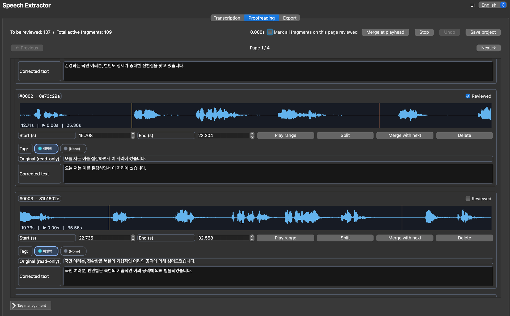

<div align="center">
  <picture>
    
  </picture>

  <h1>SPEECH EXTRACTOR</h1>

  <strong>Automatic Speech Extractor for YTPMV Production</strong><br><br>
  <picture>
    
  </picture>

[**English**](./README.md) | [**한국어**](./README.ko.md) | [**日本語**](./README.ja.md)

  <a href="#introduction"><strong>Introduction</strong></a> |
  <a href="#installation"><strong>Installation</strong></a> |
  <a href="#cautions"><strong>Cautions</strong></a> |
  <a href="#etc"><strong>ETC</strong></a>
</div>

> Developed through [ChatGPT](https://chatgpt.com) vibe coding

> Supports multiple platforms, including Windows, macOS, and Linux (verified on 64-bit Windows and Apple Silicon)

> **<u>This extractor does not provide noise or background music removal functionality.</u>** Before using it, please perform audio source separation using a separate application such as [UVR](https://github.com/anjok07/ultimatevocalremovergui) or [MSST](https://github.com/SUC-DriverOld/MSST-WebUI).

> This extractor extracts sources in phrase or sentence units, making it optimized for dialogue-based content such as roleplay scenarios and rap production. For pronunciation training purposes, we recommend using Orange0929's [source extractor](https://github.com/Orange0929/Source_extractor), which splits audio into syllable-level units.

> For inquiries regarding the code or other matters, please leave a comment at [this DCinside post](https://gall.dcinside.com/videocomp/7138).

## Introduction

Developed by HangsUs AI Study Group under Korean Politics Composition Laboratory of Moo-hyun & Moon Disaster Society, this application utilizes [Faster Whisper](https://github.com/SYSTRAN/faster-whisper) to automatically transcribe audio sources required for YTPMV production. It provides audio packs consisting of 48kHz 16-bit WAV files that can also be used with Melodyne and VocalShifter, as well as SRT subtitle files, allowing integration with video synthesis workflows and making the process more convenient for voice synthesizers. The application's detailed features are as follows:

- This application uses `uv sync` to quickly install the packages required for operation and easily manage their versions.
- The application language can be changed to English (default), Korean, or Japanese through the language settings tab in the upper-right corner when launching the program.
- You can designate a dedicated workspace for source analysis by configuring a project directory. Each project is identified by a UUID to prevent duplication (project names may be duplicated, so please be careful not to confuse them).
- You can modify text that was not fully corrected by loading an existing project.
- Using the PyAV module, source audio/video files are automatically converted into PCM S16LE, 48 kHz stereo/mono WAV files (fixed filename: `reference.wav`).
- You can freely select a Whisper Model, and the application automatically processes it to run on CTranslate2. CUDA acceleration is supported on Windows.
- [Silero VAD](https://github.com/snakers4/silero-vad), built into Faster Whisper, helps prevent hallucinations that can occur during prolonged transcription with Whisper and improves transcription accuracy (VAD settings are also customizable).
- After transcription is completed, the Proofreading tab allows you to adjust the timing of each phrase/sentence as well as correct incorrectly transcribed text. Each page contains 30 sentences, and you can check proofreading completion individually or in bulk for an entire page.
- Clicking on the waveform moves the playback position to the selected location. Holding down the `Shift` key while clicking sets the starting point, while holding down the `Ctrl/Cmd` key while clicking sets the ending point. You can also adjust the boundaries by dragging the start and end markers. The segment playback function can be activated with the `Space` key, while automatically checking the replacement checkbox and moving to the next sentence after proofreading can be done with the `Enter` key.
- Segment splitting, merging, and deletion functions are implemented. You can split a segment into two parts by pressing the `S` key on the playback timeline, or merge it with the following segment by pressing `CTRL(CMD) + M`. If you accidentally split, merge, or delete a segment, you can undo the action using the Undo button or by pressing `CTRL(CMD) + Z`.
- Although automatic speaker diarization was not implemented due to code complexity and limited practical effectiveness, the tagging feature allows you to manually assign up to 10 speakers. Tags can be managed by expanding or collapsing the management section at the bottom of the Proofreading tab. For better visibility, you can assign different colors to each speaker (tag) and configure a default tag. Sentences assigned to tags will later be exported into separate folders according to their respective tags.
- Even if you need to stop proofreading midway, the project saving feature allows you to resume your work by loading the saved project.
- During export, you can choose whether to prepend sequential numbers to filenames according to sentence order (with leading zeros added to match the number of digits), as well as whether to export everything as a ZIP archive. Even when the ZIP archive option is selected, the generated WAV files are not automatically deleted.
- During export, PyAV generates individual WAV files for each sentence, trimmed according to their timecodes, along with a complete SRT subtitle file with the fixed filename `ai_subtitle.srt` (there is no option to disable subtitle generation).
- Completed projects are not immediately deleted but instead moved to the Recycle Bin/Trash using the `send2trash` module (however, on Windows, a project cannot be deleted while it is open). Therefore, even if you accidentally delete a project, you can restore it.

## Installation

Officially, this application recommends using the package manager [uv](https://github.com/astral-sh/uv) for fast and convenient installation. For installation instructions specific to your operating system or environment, please refer to the [official uv documentation](https://docs.astral.sh/uv/getting-started/installation). All dependency packages required for runtime and model conversion, including Faster Whisper and PyAV, are listed in `pyproject.toml`. Therefore, a separate `requirements.txt` file is not provided. Please note that resolving dependencies may require several GB of disk space, as the project includes multiple large packages such as Torch. FFmpeg does not need to be installed separately, as its libraries are included in the PyAV wheels.

After installing uv, Windows, macOS, and Linux users can clone the Speech Extractor repository using git or manually download it (by clicking the green Code button at the top and selecting Download ZIP). Then, simply execute `run_windows.bat` on Windows or `run_macos_linux.sh` on macOS or Linux. uv will automatically install the packages and launch the application, making it very easy to use. However, the conventional method is to navigate to the application directory using the `cd` command in PowerShell or Command Prompt on Windows, or in the Terminal on macOS or Linux, and then enter the following commands to install dependencies and launch the application.

```bash
uv sync
uv run python main.py
```

Since this application has only been verified to run on 64-bit Windows and Apple Silicon Macs, additional Qt plugins or CUDA-related packages may be required on Linux, depending on your environment. Also, as of the application's release date (November 2026), the latest version of `nvidia-cublas-cu12` is [12.9.3.13](https://pypi.org/project/nvidia-cublas-cu12/12.9.3.13/#files), but only Linux wheels are distributed for this version. Therefore, if you encounter an error installing this package while resolving dependencies on Windows, please specify version 12.9.2.10 in the pyproject.toml file as follows and run the application again.

```
"nvidia-cublas-cu12==12.9.2.10; sys_platform == 'win32'"
```

### CUDA Acceleration

This application automatically selects CUDA when CTranslate2 detects a CUDA device (NVIDIA GPUs). Otherwise, it runs in CPU mode using int8. The current CTranslate2 build requires CUDA 12 and cuDNN 9 runtime libraries for GPU inference. On Windows, running `uv sync` installs the CUDA 12 cuBLAS, CUDA Runtime, and cuDNN 9 wheel packages into the project environment. Before loading CTranslate2, the application adds the corresponding DLL directories to the process's DLL search path. However, a compatible NVIDIA display driver is still required. On Linux, you must install the NVIDIA CUDA 12/cuDNN 9 runtime libraries appropriate for your distribution by following the Faster Whisper installation instructions.

On macOS, Faster Whisper does not support Metal acceleration. Therefore, you will need to separately write code to replace Whisper with [whisper.cpp](https://github.com/ggml-org/whisper.cpp) in order to utilize Metal acceleration.

## About Faster Whisper

This extractor allows users to select models from Faster Whisper developer Systran, including `Systran/faster-whisper-large-v3`, as well as the Korean-specific model `seastar105/whisper-medium-komixv2` by default (information about Systran models can be found [here](https://huggingface.co/Systran), and information about the komixv2 model can be found [here](https://huggingface.co/seastar105/whisper-medium-komixv2)). Other Whisper models can also be used.

However, unlike Systran models, which are already distributed in CTranslate2 format, most general Whisper models distributed on Hugging Face are Transformers-format checkpoints, whereas Faster Whisper uses separate CTranslate2 weights. Therefore, upon first use, the application downloads the required model files and runs ct2-transformers-converter to create a local CTranslate2 copy.

The converted files are stored in the operating system's user cache directory.

- Windows: `%LOCALAPPDATA%\speech-extractor\ctranslate2`
- macOS: `~/Library/Caches/speech-extractor/ctranslate2`
- Linux: `$XDG_CACHE_HOME/speech-extractor/ctranslate2` or `~/.cache/speech-extractor/ctranslate2`

The initial conversion may require several GB of temporary and cache disk space, and the process may take some time. Custom Hugging Face Transformers Whisper checkpoints can be used by entering either their repository ID or local folder path. However, the files must be compatible with the Transformers Whisper converter.

## Missing `tokenizer.json` in Community CTranslate2 Models

Some Whisper models may contain `model.bin` but lack `tokenizer.json`. This application detects such incomplete file configurations and uses tokenizer files from the repository to generate a faster-whisper tokenizer, then saves the generated `tokenizer.json` in the application's own model cache. The Hugging Face snapshot remains unchanged.

## Cautions
- Except for the addition of instructions and icons, the entire application was developed through ChatGPT (free model) vibe coding. Since it has only been verified under specific conditions, unexpected errors may occur depending on the user's environment. Please exercise caution when using it.
- Qt audio playback support may vary depending on the Qt Multimedia backend available on the operating system.
- For optimized compatibility with Melodyne and VocalShifter, exports are restricted to PCM16 48kHz WAV files. SRT subtitle export also cannot be disabled.
- When using the `whisper-medium-komixv2` model with the default settings, transcription tends to be performed at the paragraph level rather than at the sentence or clause level. As a result, some segments may be left untranscribed. If you encounter this issue, please note that disabling the `condition_on_previous_text` option in the Whisper settings (setting it to False) can help reduce the number of missing segments.
- To prevent accidental loss of projects, the delete function only moves project folders to the Recycle Bin/Trash. To permanently delete a project folder, you must also delete it from the Recycle Bin/Trash.
- On Windows, there is a known issue that prevents you from deleting a project while it is open. To delete the project, please click the New Project button or restart the application first, then try deleting it.

## ETC

This application is licensed under the MIT License, allowing you to freely modify and distribute its source code. You are also welcome to fork the repository, make your own improvements, and distribute your own version. Finally, we would like to express our gratitude to 문코 for the inspiration and assistance provided during the development of this application, and to 물리는노무현 for granting permission to use the logo.
